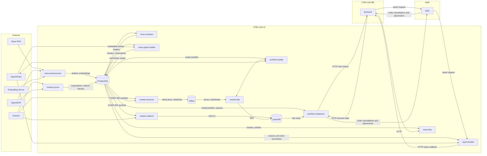
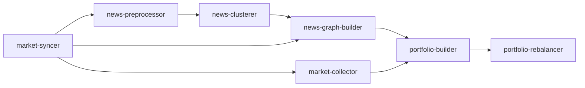

# 투자 에이전트

척척개미단의 주식 투자 에이전트

## 전체 아키텍처



## 서비스 실행 의존 관계

화살표는 앞 서비스의 데이터가 준비된 후 뒤 서비스를 실행한다는 뜻입니다. PostgreSQL과 QuestDB 마이그레이션은 해당 서비스를 실행하기 전에 적용합니다.



## 서비스별 역할

### `news-preprocessor`: 뉴스 가져와서 저장하기

- 경제 뉴스 RSS를 읽고 각 사이트의 본문 구조에 맞게 기사 추출
- OpenDART에서 `corporation_indices`의 KOSPI 200 종목 공시를 읽어 기사처럼 저장함. 정기보고서·감사보고서·증권신고서처럼 긴 공시는 제외하고, 문서가 비어 있거나 없는 공시는 제목만 저장함
- 기사 제목과 본문을 PostgreSQL `articles`에 저장 후 임베딩 시도
- 임베딩은 OpenAI API와 호완되는 서버로 요청을 보내며 2000차원으로 임베딩

### `news-clusterer`: 저장된 뉴스 클러스터링하기

- PostgreSQL에서 임베딩이 있는 기사를 모두 가져와 코사인 거리 기반 DBSCAN을 계산
  - 이 때 두 개의 환경변수를 사용하며, `NEWS_CLUSTERER_EPS`는 이웃으로 볼 최대 거리를, `NEWS_CLUSTERER_MIN_SAMPLES`는 핵심점에 필요한 최소 기사 수를 정함
- `clusters`, `article_clusters`에 기사의 클러스터 정보를 저장하고 클러스터에 속하지 않는 기사는 노이즈로 처리함
- 실행마다 기사 수, 군집 수, 소요 시간, 최대 메모리를 기록해, 전체 재계산을 증분 방식으로 바꿀 시점을 판단함

### `market-syncer`: KOSPI 200 종목과 테마 정보 업데이트하기

- 키움의 KOSPI 종목코드와 OpenDART의 기업 고유번호를 연결해 `corporations`, `corporation_aliases`를 업데이트함
- 키움에서 KOSPI 200 구성 종목과 테마별 종목을 받아 `corporation_indices`, `themes`, `theme_companies`를 업데이트함

### `news-graph-builder`: 클러스터링 된 뉴스에서 지식 정보 추출하기

- 클러스터링 된 전체 기사의 제목과 본문 전체를 LLM 서버에 보내 제목과 요약, 지식 데이터를 한 번에 추출함

### `news-http`: 백엔드에 뉴스 데이터 제공하기

- 백엔드가 사설망에서 호출하는 읽기 전용 HTTP API이며 인증은 없음
- `GET /stocks/{stock_code}/clusters`는 종목을 언급한 뉴스 클러스터를 최신 기사 순으로 반환함
- `GET /clusters/{cluster_id}/articles`는 클러스터에 속한 기사를 최신 순으로 반환하며, 본문은 포함하지 않음
- `GET /clusters/search`, `GET /clusters/{cluster_id}`, `GET /news/recent`, `GET /graph/neighborhood`, `GET /graph/paths`로 검색, 요약 뉴스, 지식 그래프를 조회할 수 있음
- 두 목록 모두 `limit`와 `cursor`로 무한 스크롤을 지원하며 응답의 `next_cursor`가 `null`이면 마지막 페이지임
- 클러스터링이 다시 실행되면 클러스터가 사라질 수 있어 이전에 받은 클러스터 id에도 404가 올 수 있음
- 포트폴리오 빌더도 이 API를 통해 뉴스와 그래프 데이터를 조회함

### `market-collector`: 시장에서 OHLCV 데이터 수집하기

- PostgreSQL의 `corporation_indices`에서 현재 KOSPI 200 종목을 읽어오고, 종목과 시간 단위별 마지막 저장 시점을 확인한 후 키움에서 빠진 데이터를 가져와 QuestDB에 저장함
- QuestDB의 `bars_15m`, `bars_1h`는 `bars_1m` 을 통해 생성함
- 평일 08:55에 한 번 시작해 09:00–15:30 매분 `:05`에 1분봉을 갱신하고, 15:35에 일봉까지 수집한 뒤 종료함. 키움 토큰과 클라이언트는 하루 동안 재사용함
- 한 번의 수집이 1분을 넘기면 `archive_pass_slow` 경고 로그를 남기고 다음 수집을 바로 시작함
- 장 마감 후 실행하면 마감 수집을 한 번 하고 바로 종료함
- `ktb_core.krx.KRX_HOLIDAYS` 기준 휴장일에는 아무것도 하지 않고 바로 종료함

### `market-streamer`와 `market-http`: 실시간 가격과 호가 제공

- market-streamer는 하나의 Kiwoom WebSocket에서 가격 `0B`와 호가 `0D`를 함께 구독함
- market-http의 `GET /orderbooks?codes=005930,000660`은 저장된 최신 호가를 반환하고, `GET /orderbooks/stream?codes=005930,000660`은 SSE로 초기 스냅샷과 이후 갱신을 전달함
- 각 호가 스냅샷은 최우선 순서로 매도·매수 각각 10개 가격과 수량을 포함함
- `ts`는 거래일과 Kiwoom 호가 시각을 합친 값으로, 마지막 스냅샷의 신선도를 판단하는 데 사용함
- 기존 가격 API는 `/prices`, `/prices/stream`임

### `portfolio-builder`: 수집하고 추출한 정보를 바탕으로 투자 포트폴리오 생성하기

- PostgreSQL의 이전 포트폴리오와 news-http의 최근 뉴스, 관련 기업과 테마를 묶어 에이전트의 시작 자료를 생성함
- 에이전트는 세 개의 도구(뉴스 검색, 그래프 탐색, QuestDB OHLCV에 대한 기술적 분석)를 호출해 투자 포트폴리오를 생성함
- 생성된 포트폴리오를 이전 포트폴리오와 비교해 편입 대상과 편출 대상을 선정하고, `portfolios`, `portfolio_holdings`, `portfolio_exits`에 한 버전으로 저장함
- 기술적 신호는 TA-Lib와 고정 규칙으로 계산함
- 실행 기록을 `trace`에 보관하고 별도 LLM 호출로 종목별 매수와 매도 설명을 만들어 `portfolio_reasons`에 저장함
- 설명까지 생성된 포트폴리오는 `ready` 상태로 전환

### `portfolio-rebalancer`: 생성된 투자 포트폴리오를 기반으로 유저의 투자 포트폴리오 업데이트하기

- 가장 최근 포트폴리오가 `ready` 일 때 거래 시작
- 기존 HTTP API로 백엔드의 사용자·계좌·현금·보유 종목·미체결 주문을 조회함
- 미체결 주문 취소와 좁아진 범위의 재주문 요청을 같은 계좌 SQS FIFO 그룹에 순서대로 발행하며, 편출 종목은 매도만 요청함
- 기존 보유 종목의 보유량이 목표와의 차이가 `PORTFOLIO_REBALANCER_BAND`를 넘을 때 거래
- QuestDB의 최근 1분봉 가격과 20개 일봉으로 주간 가격 경계를 계산
- 경계는 위, 아래로 두 개 생성하며, 매도일 때는 높은 가격에 시도 후 낮은 가격에 도달하면 시장가 매도, 매수일 때는 낮은 가격에 시도 후 높은 가격에 도달하면 시장가 매수를 진행함
- 주문마다 `portfolio_reasons`을 백엔드에 보냄

### `report-builder`: 대회 종료 투자 리포트 생성하기

- SQS에서 대회 참가자의 주문에 연결된 투자 이유 ID를 하나씩 받아 처리함
- 선택된 이유와 해당 포트폴리오 설명, 인용된 뉴스 요약만으로 한국어 thoughts를 생성함
- Backend에 결과를 전달한 뒤에만 SQS 메시지를 삭제함

## 로컬 개발 환경에서 실행

저장소 루트에서 `.env.example`을 `.env`로 복사해 해당 작업의 필수 값을 환경에 설정합니다.

### 스키마 적용하기

```bash
docker compose -f compose.local.yaml up -d postgres questdb
uv run alembic upgrade head
KTB_QUESTDB_CONF='ws::addr=localhost:9000;' uv run python infrastructure/questdb/migrate.py
```

### 각 서비스 실행하기

```bash
docker compose -f compose.local.yaml up -d news-http
docker compose -f compose.local.yaml run --rm news-preprocessor
docker compose -f compose.local.yaml run --rm news-clusterer
docker compose -f compose.local.yaml run --rm market-syncer
docker compose -f compose.local.yaml run --rm news-graph-builder
docker compose -f compose.local.yaml run --rm market-collector
docker compose -f compose.local.yaml run --rm portfolio-builder
docker compose -f compose.local.yaml run --rm portfolio-rebalancer
docker compose -f compose.local.yaml up report-builder
```

## 데이터베이스 (ERD): [mermaid.live](https://mermaid.live/edit#pako:eNrNWO9P20YY_ldO_tRqAZGkUMg3BFSbQG1VWk2akKyLfSRubV90Pq-EUIlVpKItnboNWraGDW3VqlZMCj_GMqn9h-LL_7A7_4pjx4ZoH7Z88_l97n2f9973uddpSApWkVSSEJnXYIVAY8UE_AcJ1RQdWWBjY2wMbwTPsqLbFkXEAiWwIvW-OXN-OWLP3va22oA92WFPXoArTrPDDs7Y79vOs13Qe_UUsNdP2MHO1RXJ2zncQey80Ri-c_fPI7Z1DLqdNnt8NBTJY_KfZcs2DEg05EHZT7ts79NwTCPEIJNqNIS86nQ7T0G33WInZ2lIgnRINWz6kHNuuw-iGQiA4dZZLtOMB71Y2CYKupwthaSCaBg9JjVM_NdBIP01GeoatPxYnNMt9vcfl0VqpqopQeLebbJtnoVvO-znZvoGG2CAuzjV103AC8X5oZXlllaRwQsDGzVoxhPnvsu09GuI_dp0PrwPYNwHXcW6hkNouCJXsa5qZsWvbZfTCGi0ptE-9Lw1ApQgaIWF5aL4kQC29db50MzKT0rowlQWbX05bD_wEYHRsAegMQlpeM_iV9YqmkmBpoLbi_1VitYo8God3FsM6x58BvgLREyoyxzBWofs4GMQWoiLmtyLb2oTPbbC61BHsbUyVuuRJY0XFoVGja6Dml3WNauKVBlScTgHHefFMW_3RBQEPpRrsK5jqAq7Ny-d0w64s7wM2N4Wl8NeszUAibhYRVQJHfDW4MBu-3tg4odXrkYxXyOFYiIXJiYmADLKSBUHziGmreuwrKMc-Pzm8peAfdrlkskDBYlgH8WE7eJziYRp11RIwzCj8txtbwKnvets7jjvz7iIHrPnhzGXCY1Pug5M3BBy4MZiwiLQUW5xQxTJrZtgfmFp4e4CmJtdnpudXxjOM3I9NLL29Lxm7ZtZQ56XlDIK3Awk0buoentcKZ632OFLdrAfns143zKtbnxa657RAPFo1zbicVKsPHA7lTMO9YZXTUSLQ-Owq722nJ-9cxd0Tw95Jzon2739TgJgQiOeGB7kAyT4Lt5avv1Fsn3NiixQkUpOZVw3lUy24a0WJ-2ue3xNTAz-uI5A96TdPU3qSSRBQREO8RTcgpnpHSxj9z3HoTWPsBuOmxTe07HaDe_Ly2mnUB8_iXwq4dMWEPLT-67FO3ToGV0mEbReQ1m5id_kzrudHOj-xYXnxw64eW9pKaUfM7iN3I4-zt2yHtcO329_TLowmaMqTQTjXVlyP5IhCuaNaCk2aTlXkaUQrSYYDNDyB6B4AQaTUNDfvcdv2ZtNdxnKFdHO6kVde2HLxaetzBguraqJ1rkw8xjrCJpAs2QD3sdEsG3uOO-2Afvto1BXV9r498eRc74ZK8bIODbSNajwoYdmjgMq5jMDAgq0qvJDpFWqNCGqhsFLYPCycJWSU4-MK_f5cFUGlEAl2YaQ2hYPAK3VdGh6ilRDppgIcrzeoVrPgei7VajpSE1LQX96TKaibzTaFekVR30AFb2XxhOzZiR3Q9PmTZsp14QXrQwJgXWgaOKE-k1spdD2Bt__mnOE3L_kE8zj_wtGlhYoUNmuA96cFtL1C3l7Ne-tior0mUo5qUI0VSpRYqOcZCB-dYlHyaXKv32F4KxI4kOEINVeG1P50DGmYB0T4VLgOY-vMDaCLQi2K1WptAp1iz9505b_B0howhsKkTlsm1Qq5SfcLaRSQ1qTSsWZifHidHE6ny_kpyYLk4WcVJdKk9PjhcLE1PS1wvXizMz1fOFRTlp3fRbHr_EXk8XJ6fxUfqYwVbj-6B_sZiCG) 에서 보기


| 테이블 | 관리 주체 서비스 | 마이그레이션 |
|---|---|---|
| `articles` | `news-preprocessor` | `0001` |
| `clusters`, `article_clusters` | `news-clusterer` | `0002` |
| `cluster_summaries`, `entities`, `cluster_entities`, `relations` | `news-graph-builder` | `0003` |
| `corporations`, `corporation_aliases`, `corporation_indices`, `themes`, `theme_companies` | `market-syncer` | `0003`, `0004`, `0006` |
| `portfolios`, `portfolio_holdings`, `portfolio_exits` | `portfolio-builder` | `0005`, `0006` |
| `portfolio_reasons` | `portfolio-builder` | `0007` |
| `portfolios.status` | `portfolio-builder` | `0008` |
| `portfolio_reasons.id` | `portfolio-builder` | `0010` |

## 리밸런서 통신 경로

| 작업 | 경로 |
|---|---|
| 사용자·계좌 정보 조회 | 기존 HTTP `GET /api/v1/users/ai-server` |
| 주문 생성 요청 | AI → Order FIFO 큐; `order.place` |
| 주문 취소 요청 | AI → 같은 Order FIFO 큐; `order.cancel` |
| HTTP 조회·응답 검증 실패 | 구조화 로그 기록 후 실패 종료 |

매 실행 시작에 HTTP로 사용자 정보를 한 번 조회합니다. 조회한 잔고·보유량과 남은 실행 횟수로
범위·수량을 계산하고, 대기 주문 취소 요청 다음에 재주문 요청을 같은 계좌 FIFO 그룹으로 바로 발행합니다.
취소 반영을 기다리는 HTTP 재조회나 대기 주문 잔존에 따른 보류는 하지 않습니다.
취소 요청 발행이 실패한 계좌에는 신규 주문을 보내지 않습니다. 편출 종목은 매도만 요청하며
이번 매도의 예상 대금은 매수 예산에 더하지 않습니다.
취소 메시지 발행 성공은 취소 완료가 아닙니다. 백엔드는 같은 그룹의 취소 처리를 마친 뒤 다음 주문을 처리해야 합니다.
조회 실패나 잘못된 응답은 기존 구조화 로그로 기록하고 주문 요청 없이 종료합니다.
`users: []`는 정상 응답입니다.

주문 생성에는 `reason_id`를 포함하며 계좌 ID를 `MessageGroupId`, `eventId`를
`MessageDeduplicationId`로 사용합니다. SDK 재시도는 동일 eventId와 본문을 유지합니다.
FIFO 전송 중복 제거는 SQS의 5분 범위이며, HTTP 실행마다 재계산한 주문은 새 이벤트입니다.
계정 스냅샷 큐·복구 DB 상태·별도 스냅샷 마이그레이션은 사용하지 않습니다.

HTTP 사용자 조회는 기존 `ktb_core.backend_auth`의 JWT 쿠키를 사용합니다.
큐 URL과 HTTP 설정은 다른 서비스처럼 배포 `.env`에서 Compose `environment`를 거쳐
Settings로 읽습니다. 직접 실행은 `uv run --env-file .env portfolio-rebalancer`를 사용합니다.
SQS는 SDK 기본 인증 체인과 EC2 IAM Role을 사용하며 Access Key를 직접 지정하지 않습니다.
기존 `ktb_core.logging`으로 SQS MessageId·eventId·correlationId·처리 결과를 기록합니다.
리밸런서는 기존 Order FIFO 큐에 주문 생성·취소만 발행하며 소비·DeleteMessage를 수행하지 않습니다.
DLQ에 직접 발행하거나 일반 소비자를 연결하지 않습니다.

## 배포 Secret · Variable 목록

값은 이 문서와 Terraform에 적지 않습니다. 이름과 용도만 기록하고, 실제 값은 `gh secret set` / `gh variable set` / `aws ssm put-parameter`로 직접 등록하며 원본은 비밀번호 관리자에 보관합니다. (GitHub Secret은 등록 후 다시 조회할 수 없습니다.)

### GitHub (KTB4-11th-AI)

| 이름 | 종류 | 범위 | 사용처 | 내용 |
|---|---|---|---|---|
| `AWS_ECR_PUSH_ROLE_ARN` | Variable | Repository | `ci-main.yaml`, `ci-dev.yaml` | Public ECR push용 OIDC Role ARN |
| `PUBLIC_ECR_AI_REPOSITORY_URI` | Variable | Repository | CI·CD 전체 | AI 통합 이미지 저장소 URI. `cd-ecs-v2.yaml`은 CI Dev가 push한 `:<커밋 SHA>` 이미지를 배포 |
| `EC2_HOST`, `EC2_USER` | Secret | Repository | `cd.yaml` | 운영 AI EC2 SSH 주소·사용자 |
| `EC2_SSH_PRIVATE_KEY`, `EC2_SSH_KNOWN_HOSTS` | Secret | Repository | `cd.yaml` | 운영 AI EC2 SSH 키·호스트 키 |
| `EC2_HOST`, `EC2_USER`, `EC2_SSH_PRIVATE_KEY`, `EC2_SSH_KNOWN_HOSTS` | Secret | Environment `development` | `cd-dev.yaml` | 개발 AI EC2 SSH 접속 정보 |
| `PROD_AI_ENV` | Secret | Repository | `cd.yaml` | 운영 AI EC2 `~/ai/.env` 파일 전체. CD가 배포마다 서버에 씀 |
| `AWS_ECS_DEPLOY_ROLE_ARN` | Variable | Repository | `cd-ecs-v2.yaml` | V2 ECS 배포용 OIDC Role ARN (Cloud `ecs` root에서 생성) |

`cd.yaml`은 배포마다 `PROD_AI_ENV`를 서버의 `~/ai/.env`로 덮어씁니다. 서버에서 `.env`를 직접 고치면 다음 배포에서 사라지므로 Secret을 갱신합니다. 비어 있으면 배포 전에 실패하며, 배포가 실패하면 이전 `.env`로 되돌립니다. 기존 운영 `.env` 값에 더해 다음이 들어가야 합니다.

- `AI_PRIVATE_IP`: PostgreSQL `5432`·QuestDB `9000`을 게시할 private IP (V2 ECS market 서비스가 접근)
- `PORTFOLIO_BUILDER_MARKET_HTTP_BASE_URI=https://stock-spoon.com/market`: 운영 EC2에는 market-http가 없으므로 V2 ECS를 호출

```bash
gh secret set PROD_AI_ENV -R 100-hours-a-week/KTB4-11th-AI < prod.env   # 갱신 후 마지막 CD를 Re-run
```

### AWS SSM Parameter Store (V2 ECS)

market-http·market-streamer는 운영 EC2가 아니라 V2 ECS에서 실행되며, 비밀값은 Task 시작 시 SSM SecureString에서 주입됩니다. 일반 값은 Cloud 레포 `ecs` root의 Task Definition에 있습니다.

market-http의 운영 Task Definition에는 `MARKET_HTTP_DOCS_ENABLED=false`를 설정해야 합니다. 프록시가 `/market`을 제거하는 비운영 환경에서 문서를 제공할 때는 `MARKET_HTTP_DOCS_PATH_PREFIX=/market`을 설정합니다.

| 이름 | 사용처 |
|---|---|
| `/stockspoon/v2/prod/market-streamer/POSTGRES_DSN` | market-streamer (V1 AI 운영 PostgreSQL, `AI_PRIVATE_IP:5432`) |
| `/stockspoon/v2/prod/market-streamer/KIWOOM_APP_KEY` | market-streamer |
| `/stockspoon/v2/prod/market-streamer/KIWOOM_SECRET_KEY` | market-streamer |

값을 바꾼 뒤에는 `aws ecs update-service --cluster stockspoon-v2-prod-cluster --service stockspoon-v2-prod-market-streamer --force-new-deployment`로 Task를 교체해야 반영됩니다.
