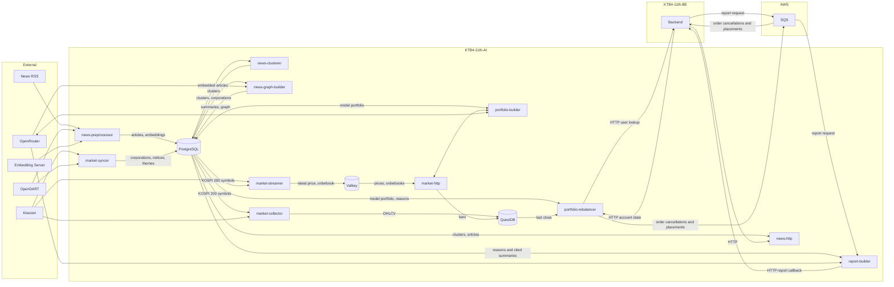
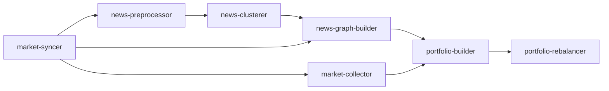

# 투자 에이전트

척척개미단의 주식 투자 에이전트

## 전체 아키텍처



## 서비스 실행 의존 관계

화살표는 앞 서비스의 데이터가 준비된 후 뒤 서비스를 실행한다는 뜻입니다. PostgreSQL과 QuestDB 마이그레이션은 해당 서비스를 실행하기 전에 적용합니다.



## 서비스별 역할

### `news-preprocessor`: 뉴스 가져와서 저장하기

- 경제 뉴스 RSS를 읽고 각 사이트의 본문 구조에 맞게 기사 추출
- OpenDART에서 `corporation_indices`의 KOSPI 200 종목 공시를 읽어 기사처럼 저장함. 정기보고서·감사보고서·증권신고서처럼 긴 공시는 제외하고, 문서가 비어 있거나 없는 공시는 제목만 저장함
- 기사 제목과 본문을 PostgreSQL `articles`에 저장 후 임베딩 시도
- 임베딩은 OpenAI API와 호완되는 서버로 요청을 보내며 2000차원으로 임베딩

### `news-clusterer`: 저장된 뉴스 클러스터링하기

- PostgreSQL에서 임베딩이 있는 기사를 모두 가져와 코사인 거리 기반 DBSCAN을 계산
- `clusters`, `article_clusters`에 기사의 클러스터 정보를 저장하고 클러스터에 속하지 않는 기사는 노이즈로 처리함
- 실행마다 기사 수, 군집 수, 소요 시간, 최대 메모리를 기록해, 전체 재계산을 증분 방식으로 바꿀 시점을 판단함

### `market-syncer`: KOSPI 200 종목과 테마 정보 업데이트하기

- 키움의 KOSPI 종목코드와 OpenDART의 기업 고유번호를 연결해 `corporations`, `corporation_aliases`를 업데이트함
- 키움에서 KOSPI 200 구성 종목과 테마별 종목을 받아 `corporation_indices`, `themes`, `theme_companies`를 업데이트함

### `news-graph-builder`: 클러스터링 된 뉴스에서 지식 정보 추출하기

- 클러스터링 된 전체 기사의 제목과 본문 전체를 LLM 서버에 보내 제목과 요약, 지식 데이터를 한 번에 추출함

### `news-http`: 백엔드에 뉴스 데이터 제공하기

- 백엔드가 사설망에서 호출하는 읽기 전용 HTTP API이며 인증은 없음
- `GET /stocks/{stock_code}/clusters`는 종목을 언급한 뉴스 클러스터를 최신 기사 순으로 반환함
- `GET /clusters/{cluster_id}/articles`는 클러스터에 속한 기사를 최신 순으로 반환하며, 본문은 포함하지 않음
- `GET /clusters/search`, `GET /clusters/{cluster_id}`, `GET /news/recent`, `GET /graph/neighborhood`, `GET /graph/paths`로 검색, 요약 뉴스, 지식 그래프를 조회할 수 있음
- 두 목록 모두 `limit`와 `cursor`로 무한 스크롤을 지원하며 응답의 `next_cursor`가 `null`이면 마지막 페이지임
- 클러스터링이 다시 실행되면 클러스터가 사라질 수 있어 이전에 받은 클러스터 id에도 404가 올 수 있음
- 포트폴리오 빌더도 이 API를 통해 뉴스와 그래프 데이터를 조회함

### `market-collector`: 시장에서 OHLCV 데이터 수집하기

- PostgreSQL의 `corporation_indices`에서 현재 KOSPI 200 종목을 읽어오고, 종목과 시간 단위별 마지막 저장 시점을 확인한 후 키움에서 빠진 데이터를 가져와 QuestDB에 저장함
- QuestDB의 `bars_15m`, `bars_1h`는 `bars_1m` 을 통해 생성함
- 평일 08:55에 한 번 시작해 09:00–15:30 매분 `:05`에 1분봉을 갱신하고, 15:35에 일봉까지 수집한 뒤 종료함. 키움 토큰과 클라이언트는 하루 동안 재사용함
- 한 번의 수집이 1분을 넘기면 `archive_pass_slow` 경고 로그를 남기고 다음 수집을 바로 시작함
- 장 마감 후 실행하면 마감 수집을 한 번 하고 바로 종료함
- `ktb_core.krx.KRX_HOLIDAYS` 기준 휴장일에는 아무것도 하지 않고 바로 종료함

### `market-streamer`와 `market-http`: 실시간 가격과 호가 제공

- market-streamer는 하나의 Kiwoom WebSocket에서 가격 `0B`와 호가 `0D`를 함께 구독함
- market-http의 `GET /orderbooks?codes=005930,000660`은 저장된 최신 호가를 반환하고, `GET /orderbooks/stream?codes=005930,000660`은 SSE로 초기 스냅샷과 이후 갱신을 전달함
- 각 호가 스냅샷은 최우선 순서로 가격이 양수인 매도·매수 각각 최대 10개 가격과 수량을 포함하며, 빈 단계는 제외함
- `ts`는 거래일과 Kiwoom 호가 시각을 합친 값으로, 마지막 스냅샷의 신선도를 판단하는 데 사용함
- 기존 가격 API는 `/prices`, `/prices/stream`임

### `portfolio-builder`: 수집하고 추출한 정보를 바탕으로 투자 포트폴리오 생성하기

- PostgreSQL의 이전 포트폴리오와 news-http의 최근 뉴스, 관련 기업과 테마를 묶어 에이전트의 시작 자료를 생성함
- 에이전트는 세 개의 도구(뉴스 검색, 그래프 탐색, QuestDB OHLCV에 대한 기술적 분석)를 호출해 투자 포트폴리오를 생성함
- 생성된 포트폴리오를 이전 포트폴리오와 비교해 편입 대상과 편출 대상을 선정하고, `portfolios`, `portfolio_holdings`, `portfolio_exits`에 한 버전으로 저장함
- 기술적 신호는 TA-Lib와 고정 규칙으로 계산함
- 실행 기록을 `trace`에 보관하고 별도 LLM 호출로 종목별 매수와 매도 설명을 만들어 `portfolio_reasons`에 저장함
- 설명까지 생성된 포트폴리오는 `ready` 상태로 전환

### `portfolio-rebalancer`: 생성된 투자 포트폴리오를 기반으로 유저의 투자 포트폴리오 업데이트하기

- 가장 최근 포트폴리오가 `ready` 일 때 거래 시작
- 기존 HTTP API로 백엔드의 사용자·계좌·현금·보유 종목·미체결 주문을 조회함
- 미체결 주문 취소와 좁아진 범위의 재주문 요청을 같은 계좌 SQS FIFO 그룹에 순서대로 발행하며, 편출 종목은 매도만 요청함
- 기존 보유 종목의 보유량이 목표와의 차이가 `PORTFOLIO_REBALANCER_BAND`를 넘을 때 거래
- QuestDB의 최근 1분봉 가격과 20개 일봉으로 주간 가격 경계를 계산
- 경계는 위, 아래로 두 개 생성하며, 매도일 때는 높은 가격에 시도 후 낮은 가격에 도달하면 시장가 매도, 매수일 때는 낮은 가격에 시도 후 높은 가격에 도달하면 시장가 매수를 진행함
- 주문마다 `portfolio_reasons`을 백엔드에 보냄

### `report-builder`: 대회 종료 투자 리포트 생성하기

- SQS에서 대회 참가자의 주문에 연결된 투자 이유 ID를 하나씩 받아 처리함
- 선택된 이유와 해당 포트폴리오 설명, 인용된 뉴스 요약만으로 한국어 thoughts를 생성함
- Backend에 결과를 전달한 뒤에만 SQS 메시지를 삭제함

## 데이터베이스 (ERD): [mermaid.live](https://mermaid.live/edit#pako:eNrNWO9P20YY_ldO_tRqAZGkUMg3BFSbQG1VWk2akKyLfSRubV90Pq-EUIlVpKItnboNWraGDW3VqlZMCj_GMqn9h-LL_7A7_4pjx4ZoH7Z88_l97n2f9973uddpSApWkVSSEJnXYIVAY8UE_AcJ1RQdWWBjY2wMbwTPsqLbFkXEAiWwIvW-OXN-OWLP3va22oA92WFPXoArTrPDDs7Y79vOs13Qe_UUsNdP2MHO1RXJ2zncQey80Ri-c_fPI7Z1DLqdNnt8NBTJY_KfZcs2DEg05EHZT7ts79NwTCPEIJNqNIS86nQ7T0G33WInZ2lIgnRINWz6kHNuuw-iGQiA4dZZLtOMB71Y2CYKupwthaSCaBg9JjVM_NdBIP01GeoatPxYnNMt9vcfl0VqpqopQeLebbJtnoVvO-znZvoGG2CAuzjV103AC8X5oZXlllaRwQsDGzVoxhPnvsu09GuI_dp0PrwPYNwHXcW6hkNouCJXsa5qZsWvbZfTCGi0ptE-9Lw1ApQgaIWF5aL4kQC29db50MzKT0rowlQWbX05bD_wEYHRsAegMQlpeM_iV9YqmkmBpoLbi_1VitYo8God3FsM6x58BvgLREyoyxzBWofs4GMQWoiLmtyLb2oTPbbC61BHsbUyVuuRJY0XFoVGja6Dml3WNauKVBlScTgHHefFMW_3RBQEPpRrsK5jqAq7Ny-d0w64s7wM2N4Wl8NeszUAibhYRVQJHfDW4MBu-3tg4odXrkYxXyOFYiIXJiYmADLKSBUHziGmreuwrKMc-Pzm8peAfdrlkskDBYlgH8WE7eJziYRp11RIwzCj8txtbwKnvets7jjvz7iIHrPnhzGXCY1Pug5M3BBy4MZiwiLQUW5xQxTJrZtgfmFp4e4CmJtdnpudXxjOM3I9NLL29Lxm7ZtZQ56XlDIK3Awk0buoentcKZ632OFLdrAfns143zKtbnxa657RAPFo1zbicVKsPHA7lTMO9YZXTUSLQ-Owq722nJ-9cxd0Tw95Jzon2739TgJgQiOeGB7kAyT4Lt5avv1Fsn3NiixQkUpOZVw3lUy24a0WJ-2ue3xNTAz-uI5A96TdPU3qSSRBQREO8RTcgpnpHSxj9z3HoTWPsBuOmxTe07HaDe_Ly2mnUB8_iXwq4dMWEPLT-67FO3ToGV0mEbReQ1m5id_kzrudHOj-xYXnxw64eW9pKaUfM7iN3I4-zt2yHtcO329_TLowmaMqTQTjXVlyP5IhCuaNaCk2aTlXkaUQrSYYDNDyB6B4AQaTUNDfvcdv2ZtNdxnKFdHO6kVde2HLxaetzBguraqJ1rkw8xjrCJpAs2QD3sdEsG3uOO-2Afvto1BXV9r498eRc74ZK8bIODbSNajwoYdmjgMq5jMDAgq0qvJDpFWqNCGqhsFLYPCycJWSU4-MK_f5cFUGlEAl2YaQ2hYPAK3VdGh6ilRDppgIcrzeoVrPgei7VajpSE1LQX96TKaibzTaFekVR30AFb2XxhOzZiR3Q9PmTZsp14QXrQwJgXWgaOKE-k1spdD2Bt__mnOE3L_kE8zj_wtGlhYoUNmuA96cFtL1C3l7Ne-tior0mUo5qUI0VSpRYqOcZCB-dYlHyaXKv32F4KxI4kOEINVeG1P50DGmYB0T4VLgOY-vMDaCLQi2K1WptAp1iz9505b_B0howhsKkTlsm1Qq5SfcLaRSQ1qTSsWZifHidHE6ny_kpyYLk4WcVJdKk9PjhcLE1PS1wvXizMz1fOFRTlp3fRbHr_EXk8XJ6fxUfqYwVbj-6B_sZiCG) 에서 보기

```mermaid
erDiagram
    articles ||--o| article_clusters : "클러스터 소속 (노이즈는 행 없음)"
    clusters ||--|{ article_clusters : "구성 기사"
    clusters ||--o| cluster_summaries : "요약"
    clusters ||--o{ cluster_entities : "언급 개체"
    clusters ||--o{ relations : "출처 클러스터"
    entities ||--o{ cluster_entities : ""
    entities ||--o{ relations : "source"
    entities ||--o{ relations : "target"
    corporations ||--o{ corporation_aliases : "별칭"
    corporations ||--o{ corporation_indices : "지수 편입"
    corporations ||--o| entities : "기업 노드"
    corporations ||--o{ theme_companies : ""
    themes ||--o{ theme_companies : "구성 종목"
    portfolios ||--o{ portfolio_holdings : "편입 종목"
    portfolios ||--o{ portfolio_exits : "편출 종목"
    portfolios ||--o{ portfolio_reasons : "종목별 설명"
    corporations ||--o{ portfolio_holdings : "corp_code"
    corporations ||--o{ portfolio_exits : "corp_code"
    corporations ||--o{ portfolio_reasons : "corp_code"

    articles {
        bigint id PK
        text source UK "source + external_id 유일"
        text external_id UK
        text url
        text title
        text body
        timestamptz published_at "인덱스"
        text raw_payload "원본 RSS 아이템"
        timestamptz fetched_at "기본값 now()"
        vector_2000 embedding "nullable, HNSW 코사인 인덱스"
    }
    clusters {
        bigint id PK
        timestamptz updated_at "구성 기사가 바뀌면 갱신"
    }
    article_clusters {
        bigint article_id PK, FK
        bigint cluster_id FK "ON DELETE CASCADE"
    }
    cluster_summaries {
        bigint cluster_id PK, FK "ON DELETE CASCADE"
        text title
        text summary
        timestamptz cluster_updated_at "요약한 시점의 clusters.updated_at"
        timestamptz summarized_at
    }
    corporations {
        text stock_code PK "종목코드"
        text corp_code UK "DART 고유번호"
        text name
        text market "KOSPI"
        text eng_name "nullable"
        timestamptz synced_at
    }
    corporation_aliases {
        text alias PK "normalize 결과"
        text stock_code FK
    }
    corporation_indices {
        text stock_code PK, FK
        text index_name PK "KOSPI200"
    }
    entities {
        bigint id PK
        text raw_name "처음 본 표기"
        text name "normalize 결과"
        text type
        text stock_code FK "기업 노드만, 그 외 NULL"
    }
    cluster_entities {
        bigint cluster_id PK, FK "ON DELETE CASCADE"
        bigint entity_id PK, FK
    }
    relations {
        bigint id PK
        bigint cluster_id FK "ON DELETE CASCADE"
        bigint source_entity_id FK
        bigint target_entity_id FK
        text type
        text description
    }
    themes {
        text theme_code PK "키움 thema_grp_cd"
        text name
        timestamptz synced_at
    }
    theme_companies {
        text theme_code PK, FK "ON DELETE CASCADE"
        text stock_code PK, FK "ON DELETE CASCADE"
        boolean is_major "테마 주요종목 여부"
    }
    portfolios {
        bigint id PK
        timestamptz created_at "인덱스"
        double cash_weight
        text commentary
        text model
        jsonb trace
        text status "explanation_pending, ready, explanation_failed"
    }
    portfolio_holdings {
        bigint portfolio_id PK, FK "ON DELETE CASCADE"
        text company_id PK, FK "corporations.corp_code"
        double weight
        text reason "nullable"
        bigint_array cited_cluster_ids
    }
    portfolio_exits {
        bigint portfolio_id PK, FK "ON DELETE CASCADE"
        text company_id PK, FK "corporations.corp_code"
        text reason
        bigint_array cited_cluster_ids
    }
    portfolio_reasons {
        bigint portfolio_id PK, FK "ON DELETE CASCADE"
        text company_id PK, FK "corporations.corp_code"
        text side PK "buy or sell"
        text reason
        jsonb reasonings
    }
```



| 테이블 | 관리 주체 서비스 | 마이그레이션 |
|---|---|---|
| `articles` | `news-preprocessor` | `0001` |
| `clusters`, `article_clusters` | `news-clusterer` | `0002` |
| `cluster_summaries`, `entities`, `cluster_entities`, `relations` | `news-graph-builder` | `0003` |
| `corporations`, `corporation_aliases`, `corporation_indices`, `themes`, `theme_companies` | `market-syncer` | `0003`, `0004`, `0006` |
| `portfolios`, `portfolio_holdings`, `portfolio_exits` | `portfolio-builder` | `0005`, `0006` |
| `portfolio_reasons` | `portfolio-builder` | `0007` |
| `portfolios.status` | `portfolio-builder` | `0008` |
| `portfolio_reasons.id` | `portfolio-builder` | `0010` |

## 리밸런서 통신 경로

| 작업 | 경로 |
|---|---|
| 사용자·계좌 정보 조회 | 기존 HTTP `GET /api/v1/users/ai-server` |
| 주문 생성 요청 | AI → Order FIFO 큐; `order.place` |
| 주문 취소 요청 | AI → 같은 Order FIFO 큐; `order.cancel` |
| HTTP 조회·응답 검증 실패 | 구조화 로그 기록 후 실패 종료 |

매 실행 시작에 HTTP로 사용자 정보를 한 번 조회합니다. 조회한 잔고·보유량과 남은 실행 횟수로
범위·수량을 계산하고, 대기 주문 취소 요청 다음에 재주문 요청을 같은 계좌 FIFO 그룹으로 바로 발행합니다.
취소 반영을 기다리는 HTTP 재조회나 대기 주문 잔존에 따른 보류는 하지 않습니다.
취소 요청 발행이 실패한 계좌에는 신규 주문을 보내지 않습니다. 편출 종목은 매도만 요청하며
이번 매도의 예상 대금은 매수 예산에 더하지 않습니다.
취소 메시지 발행 성공은 취소 완료가 아닙니다. 백엔드는 같은 그룹의 취소 처리를 마친 뒤 다음 주문을 처리해야 합니다.
조회 실패나 잘못된 응답은 기존 구조화 로그로 기록하고 주문 요청 없이 종료합니다.
`users: []`는 정상 응답입니다.

주문 생성에는 `reason_id`를 포함하며 계좌 ID를 `MessageGroupId`, `eventId`를
`MessageDeduplicationId`로 사용합니다. SDK 재시도는 동일 eventId와 본문을 유지합니다.
FIFO 전송 중복 제거는 SQS의 5분 범위이며, HTTP 실행마다 재계산한 주문은 새 이벤트입니다.
계정 스냅샷 큐·복구 DB 상태·별도 스냅샷 마이그레이션은 사용하지 않습니다.

HTTP 사용자 조회는 기존 `ktb_core.backend_auth`의 JWT 쿠키를 사용합니다.
SQS는 SDK 기본 인증 체인과 EC2 IAM Role을 사용하며 Access Key를 직접 지정하지 않습니다.
기존 `ktb_core.logging`으로 SQS MessageId·eventId·correlationId·처리 결과를 기록합니다.
리밸런서는 기존 Order FIFO 큐에 주문 생성·취소만 발행하며 소비·DeleteMessage를 수행하지 않습니다.
DLQ에 직접 발행하거나 일반 소비자를 연결하지 않습니다.

## EC2 배포 환경 설정

운영·개발 EC2는 GitHub Variable의 `.env` 텍스트와 SSM의 비밀 값을 합쳐 배포용 `.env`를 생성합니다.
설정 이름은 `.env.example`, 생성·주입 절차는 `.github/workflows/`의 배포 워크플로를 기준으로 확인합니다.

## 시세 추적과 CloudWatch EMF

추적 설정은 `packages/telemetry`의 `ktb_telemetry`가 담당합니다. OTLP endpoint가 없거나
`OTEL_SDK_DISABLED=true`이면 추적을 시작하지 않습니다. Compose 기본값도 비활성화입니다.
활성화할 때는 두 서비스의 `MARKET_STREAMER_OTEL_SDK_DISABLED`와
`MARKET_HTTP_OTEL_SDK_DISABLED`를 `false`로 바꾸고, 각각의
`*_OTEL_EXPORTER_OTLP_ENDPOINT`를 컨테이너에서 접근할 수 있는 수집기 주소로 설정합니다.
기본 endpoint `http://localhost:4318`은 컨테이너 자신의 loopback입니다.

| 컨테이너 설정 | Compose 호스트 설정 | 기본값 |
| --- | --- | --- |
| `OTEL_SDK_DISABLED` | 서비스 접두사 + `_OTEL_SDK_DISABLED` | `true` |
| `OTEL_EXPORTER_OTLP_ENDPOINT` | 서비스 접두사 + `_OTEL_EXPORTER_OTLP_ENDPOINT` | `http://localhost:4318` |
| `OTEL_TRACES_SAMPLER_ARG` | 서비스 접두사 + `_OTEL_TRACES_SAMPLER_ARG` | streamer `0.1`, HTTP `0.01` |
| `OTEL_RESOURCE_ATTRIBUTES` | 서비스 접두사 + `_OTEL_RESOURCE_ATTRIBUTES` | local Compose `deployment.environment=local`, prod Compose `dev` |
| `OTEL_TRACES_SAMPLER` | Compose에서 고정 | `parentbased_traceidratio` |
| `OTEL_PROPAGATORS` | market-http Compose에서 고정 | `none` |

서비스 접두사는 `MARKET_STREAMER` 또는 `MARKET_HTTP`입니다. 직접 실행할 때는 표의
컨테이너 변수 이름을 사용합니다. ECS market-http는 GitHub Actions의
`MARKET_HTTP_ENV_JSON`에 같은 컨테이너 변수와 운영 환경 구분 값을 설정합니다.
서비스 이름은 코드에서 고정하며, HTTP의 외부 요청 trace header는 무시합니다.

가격 추적은 배치별 `publish` PRODUCER span과 이를 부모로 하는 클라이언트별 `deliver`
CONSUMER span으로 구성합니다. 샘플링된 가격에만 `traceparent`와 `published_at`을 추가하며,
초기 SSE 스냅샷에는 deliver span을 만들지 않습니다. REST는 FastAPI 요청 추적을 사용하고,
연결 전체를 span으로 만들지 않도록 SSE 경로는 자동 요청 추적에서 제외합니다.

| 시점 | 의미 |
| --- | --- |
| T0 | `published_at`: Valkey 쓰기 파이프라인 실행 직전 |
| T1 | `deliver` 시작: Pub/Sub 메시지를 받은 직후 |
| T2 | `deliver` 종료: 해당 이벤트의 ASGI `send()` 반환 직후 |

`publish_to_receive_ms`는 T1−T0이며 두 호스트의 시계 동기화가 필요합니다.
Valkey가 실제 `PUBLISH`한 시점부터의 순수 전송 시간이 아닙니다. deliver 기간은 T2−T1로,
SSE 버퍼와 느린 클라이언트의 역압을 포함하지만 클라이언트 수신 완료를 뜻하지 않습니다.
잘못된 `published_at`은 해당 속성만 생략하고, 잘못된 `traceparent`는 span 없이 전달합니다.
연결 종료로 미완료 span을 닫으면 `sse.disconnected=true`이므로 지연 통계에서 제외합니다.

`MARKET_HTTP_TRACE_SPANS_PER_SECOND`는 프로세스별 deliver 생성 상한으로 기본 100이며,
0이면 생성을 중지합니다. 상한을 넘겨도 SSE 메시지는 전달합니다. 생산자 샘플링과
이 상한 때문에 Tempo span 수를 실제 처리량으로 사용하면 안 됩니다.
`MARKET_HTTP_METRICS_NAMESPACE`를 설정하면 `MARKET_HTTP_METRICS_CLUSTER_NAME`,
`MARKET_HTTP_METRICS_SERVICE_NAME`도 필요하며, 60초마다 `active_sse_connections` 로그에
CloudWatch EMF의 `ActiveSSEConnections`, `DeliverSpansRecorded`, `DeliverSpansSkipped`를
기록합니다. 마지막 두 값은 구간별 수이며 skipped 비율로 추적 표본 누락을 확인합니다.
샘플링되지 않은 원본이나 exporter에서 버린 span은 이 skipped 수에 포함되지 않습니다.

전후 성능 비교에서는 샘플링 비율, deliver 상한, 시간대와 연결 수를 맞춥니다.
Tempo 장애 시 span은 유실될 수 있지만 시세 발행과 SSE는 계속됩니다. SDK export queue는
`OTEL_BSP_MAX_QUEUE_SIZE`로 제한되며 기본값은 2048입니다. 이 값은 Compose에서 연결하지
않으므로 필요하면 컨테이너에 직접 설정합니다. span 안의 JSON 로그에는 `trace_id`, `span_id`가
추가되며 Grafana의 로그→trace 연결은 외부에서 설정합니다. FastAPI의
`telemetry={"auto_configure": False}`를 유지해 exporter 중복 구성을 막습니다.
추적 exporter 오류 로그는 시세 처리 실패와 구분해서 알림을 설정합니다.

`scripts/bench-publish-tracing.py`는 `off`, `sampled-out`, `sampled-in` 모드를 비교합니다.
선택한 Valkey DB를 비우므로 `KTB_TEST_VALKEY_URL`에 반드시 폐기용 인스턴스를 지정합니다.
이 로컬 벤치마크는 메모리 exporter를 사용하므로 네트워크 export 비용이나 VPC 성능을
검증하지 않습니다.

## QuestDB 체크포인트와 운영 진단

market-collector는 현재 PostgreSQL 구성 종목만 대상으로 물리 시간 단위 `1m`, `1d`의
최신 UTC 체크포인트를 조회합니다. 먼저 엄격한 최근 7일 조건으로 조회하고, 빠진
종목·시간 단위 쌍만 기간 제한 없이 다시 조회합니다. 구성 종목이 비면 QuestDB를 조회하지
않으며, 탈퇴 종목은 제외합니다. 정확히 7일 경계인 값과 오래된 체크포인트도 fallback으로
보존합니다. 조회 실패는 전파하며, 빈 결과로 바꿔 초기 수집을 유발하지 않습니다.

체크포인트가 없는 경우에만 중복 시각을 제거한 최신 1분봉 8,000개·일봉 300개로 초기
수집을 제한합니다. 기존 체크포인트가 있으면 저장 경계까지 페이지를 조회하고 모든 새 봉을
저장합니다. 이는 초기 요청 제한이며 보관 데이터 삭제나 TTL이 아닙니다.

portfolio-builder의 일봉 분석 universe는 PostgreSQL의 현재 KOSPI 200 구성 종목을 읽고,
market-http에서 종목별 최신 일봉 최대 300개를 가져옵니다. 과거 QuestDB 직접 조회의
400일 조건이나 symbol cast 필터를 현재 경로의 계약으로 사용하지 않습니다. 일봉 도구의
동시 첫 조회는 Lock으로 보호하고 한 에이전트 실행 안에서 첫 성공 결과를 공유합니다.
실패는 캐시하지 않으며 다음 실행에서 구성 종목과 데이터를 다시 읽습니다.

운영 체크포인트는 collector의 `checkpoint_query_phase_complete`,
`checkpoint_query_complete`, `checkpoint_query_failed` 로그로 단계별 소요 시간, 요청 종목,
반환 행, fallback/missing 쌍과 오류를 확인합니다. JVM 사용량(total−free), RSS, native/mapped
할당, GC와 컨테이너 working set을 함께 확인합니다. mapped 할당은 상주 RAM과 다르고,
전역 메트릭과 로컬 합성 데이터 벤치마크만으로 운영 메모리·GC 문제가 해결됐다고 판단하지 않습니다.

```bash
docker compose -f compose.prod.yaml exec -T questdb curl -fsS http://localhost:9003/metrics
docker compose -f compose.prod.yaml run --rm -T questdb-migrate \
  python infrastructure/questdb/inspect_checkpoint.py \
  --metrics-url http://questdb:9003/metrics --repeats 3 > checkpoint-report.json
```

진단 스크립트는 SELECT/EXPLAIN만 실행하며 마이그레이션을 적용하지 않습니다. 이전의 무제한
조회와 cutoff-only 비교를 측정하는 도구이므로 현재 recent-first/fallback 파이프라인의 시간으로
대체해서 읽으면 안 됩니다. `--compare-aggregate`는 비용이 큰 과거 전체 이력 집계를 추가합니다.
매핑 비교는 수집이 멈춘 동일 데이터에서 수행합니다. 별도 live query 사이의 동시 쓰기는
매핑 차이를 만들 수 있습니다. 짧은 조회의 전후 샘플은 정확한 메모리 최고점이 아닙니다.
실제 운영 비용이 확인되기 전에 별도 체크포인트 테이블이나 heap 증가를 해결책으로 단정하지 않습니다.

## Market Prometheus metrics

Issue: [#392](https://github.com/100-hours-a-week/KTB4-11th-AI/issues/392).

### Collection endpoints and access

Both console entry points start a dedicated Prometheus HTTP listener for the
lifetime of their process. `/metrics` is on this listener, separate from the
public market API. The API port does not expose `/metrics`. A binding failure
fails service startup; normal or exceptional exit closes the listener.

| Service | Bind environment variable | Default | Port environment variable | Default |
| --- | --- | --- | --- | --- |
| market-http | MARKET_HTTP_PROMETHEUS_BIND_HOST | 127.0.0.1 | MARKET_HTTP_PROMETHEUS_PORT | 9100 |
| market-streamer | MARKET_STREAMER_PROMETHEUS_BIND_HOST | 127.0.0.1 | MARKET_STREAMER_PROMETHEUS_PORT | 9100 |

Ports must be 1–65535, bind hosts must be nonempty. Directly running both processes
on one machine requires distinct ports, for example HTTP 9101 and streamer 9102.
Each container has its own network namespace, so both can use 9100. The supplied
Compose files pass through these variables and preserve the loopback default;
they do not publish a metrics port. Loopback means the container/task loopback,
not the Docker host. A colocated collector in the same network namespace can
scrape the default listener.

For a separate Prometheus container, explicitly set each bind host to `0.0.0.0`
and scrape `market-http:9100` and `market-streamer:9100` on a private container
network. Do not publish those container ports on a public host interface. For
host-based collection, add loopback-only mappings (HTTP `127.0.0.1:9101:9100`,
streamer `127.0.0.1:9102:9100`) in an operator-owned Compose override and still
bind to `0.0.0.0` inside the container. For VPC collection use a private interface
and security group/firewall rules permitting only the collector. These endpoints
have no application authentication; the binding and network rules enforce access.

Production market-http runs in ECS with `awsvpc`. Cloud owns the task security
group and collector configuration. `MARKET_HTTP_ENV_JSON` can pass the two
environment variables through the existing CD workflow. A collector sidecar in
the same task can use loopback; a remote collector requires the explicit bind
override and permitted task-port access. Do not add this port to the public ALB.
Cloud owns deployment and the collector infrastructure configuration.

Example private-network scrape configuration, after the explicit bind overrides:

```yaml
scrape_configs:
  - job_name: market-http
    metrics_path: /metrics
    static_configs:
      - targets: ['market-http:9100']
  - job_name: market-streamer
    metrics_path: /metrics
    static_configs:
      - targets: ['market-streamer:9100']
```

Scrape every replica separately. Registries are per process and counters reset on
restart; use `rate()` before summing replicas. The streamer exits at its configured
stop time and exposes no endpoint while stopped. Schedule availability and feed
freshness alerts for expected operating/trading hours. Do not start multiple API
workers sharing one listener port; this entry point runs one Uvicorn process.

### Metric contract

| Metric | Type | Unit | Labels | Meaning |
| --- | --- | --- | --- | --- |
| market_http_sse_connections | Gauge | connections | stream | Accepted active connections |
| market_http_sse_connections_started_total | Counter | connections | stream | Successful SSE response starts |
| market_http_sse_connections_closed_total | Counter | connections | stream, reason | Closed accepted connections |
| market_streamer_market_events_received_total | Counter | events | kind | Original entries before validation/deduplication |
| market_streamer_market_events_received_bytes_total | Counter | bytes | kind | Original entries re-encoded as compact UTF-8 JSON |
| market_http_sse_events_sent_total | Counter | events | stream | Complete data events whose ASGI send returned |
| market_http_sse_events_sent_bytes_total | Counter | bytes | stream | Wire bytes for those complete SSE data events |
| market_streamer_market_data_age_seconds | Gauge | seconds | kind | Elapsed monotonic time since original receipt |
| market_http_sse_delivery_latency_seconds | Histogram | seconds | stream | Pub/Sub receipt to completed ASGI send |
| market_http_valkey_pool_connections | Gauge | connections | state | Pool counts and in-flight acquisition requests |
| market_http_valkey_pool_acquire_duration_seconds | Histogram | seconds | result | Completed pool acquisition duration |
| market_http_valkey_pool_acquire_timeouts_total | Counter | timeouts | none | Actual acquisition timeouts |

Allowed values, and no others:

- `stream`: `prices`, `orderbooks`.
- `kind`: `price`, `orderbook`.
- `reason`: `normal`, `client_disconnect`, `cancelled`, `send_error`, `server_shutdown`, `unknown`.
- `state`: `in_use`, `available`, `acquiring`.
- `result`: `success`, `timeout`, `error`.

No user, symbol, connection, trace ID, or exception text is a label. Histogram
exposition adds the standard `le` bucket label; the client also emits standard
`_created`, `_count`, `_sum`, and `_bucket` series. Histograms use the client
library's default second-based buckets (5 ms through 10 s, plus infinity).

#### Measurement boundaries

SSE connections begin only after the accepted 200 response start has been sent;
validation failures do not count. Every accepted connection closes once, including
generator failures. `normal` means the response completed, `client_disconnect`
means ASGI received a disconnect, `cancelled` means task cancellation without a
disconnect, `send_error` means the ASGI send failed, and `unknown` covers other
failures. An observed Uvicorn shutdown signal takes precedence as
`server_shutdown`; a forced process kill cannot run cleanup or increment counters.

Event counts and bytes exclude keepalive comments and empty terminal bodies.
Complete data events are counted after the send containing their terminating
blank line returns, including events split across body chunks. Bytes include SSE
fields and delimiters, excluding HTTP/TCP/TLS overhead. ASGI success means the
server accepted the write, not that the client read or rendered it. Initial
snapshots contribute to events and bytes but not delivery latency. Live latency
includes parsing, encoding and backpressure after Pub/Sub receipt, independently
of OpenTelemetry sampling; it excludes upstream socket and Valkey transit time.

The Kiwoom SDK exposes decoded entries, not original socket-frame bytes. Received
bytes are therefore a reproducible payload-size measurement: each original
`0B`/`0D` entry serialized with compact separators and UTF-8 non-ASCII text.
This includes malformed entries and duplicates but excludes outer frame metadata,
JSON whitespace differences, socket framing, and transport overhead. It must not
be presented as measured network bandwidth. All entries in a frame are recorded
before awaiting publication. Feed age is calculated during each scrape and keeps
growing during silence; it is NaN before the first event of that kind.

The existing nonblocking Redis pool, retries, TLS and IAM configuration are
preserved. `in_use` and `available` read current pool counts (available means
created idle connections, not unused capacity). `acquiring` counts in-flight
`get_connection()` calls, including lock and connection setup time. It is not an
internal queue waiting for free capacity, and can overlap `in_use` during setup.
Pool exhaustion remains immediate and is `error`; built-in or Redis timeouts are
`timeout`. Cancellation propagates unchanged and releases in-flight accounting;
it does not fabricate a completed success/error/timeout observation. Counts are
read individually at scrape time and are not an atomic pool-wide snapshot.

CloudWatch EMF and OpenTelemetry are retained. Prometheus metrics remain active
when EMF is unset or tracing is disabled/sampled out.

### Queries for panels and alerts

```promql
sum by (kind) (rate(market_streamer_market_events_received_total[1m]))
sum by (kind) (rate(market_streamer_market_events_received_bytes_total[1m]))
sum by (stream) (rate(market_http_sse_events_sent_total[1m]))
sum by (stream) (rate(market_http_sse_events_sent_bytes_total[1m]))
sum by (stream) (market_http_sse_connections)
sum by (stream, reason) (rate(market_http_sse_connections_closed_total[5m]))
histogram_quantile(0.95, sum by (stream, le) (rate(market_http_sse_delivery_latency_seconds_bucket[5m])))
sum by (state) (market_http_valkey_pool_connections)
histogram_quantile(0.95, sum by (result, le) (rate(market_http_valkey_pool_acquire_duration_seconds_bucket[5m])))
sum(rate(market_http_valkey_pool_acquire_timeouts_total[5m]))
```

Starting alert expressions to calibrate with Cloud during trading hours:

```promql
market_streamer_market_data_age_seconds > 30
market_streamer_market_data_age_seconds != market_streamer_market_data_age_seconds
up{job=~"market-http|market-streamer"} == 0
absent(up{job="market-streamer"})
sum(rate(market_http_valkey_pool_acquire_timeouts_total[5m])) > 0
```

The NaN comparison detects a feed that has never received an event; `up` detects
a failed scrape and `absent` detects a missing target. Configure alert durations
and schedules externally rather than assuming silence means failure overnight.

### Verification

From inside each service container (or from the same network namespace), using
the default port:

```bash
docker compose -f compose.local.yaml exec market-http python -c "import urllib.request; print(urllib.request.urlopen('http://127.0.0.1:9100/metrics').read().decode())"
docker compose -f compose.local.yaml exec market-streamer python -c "import urllib.request; print(urllib.request.urlopen('http://127.0.0.1:9100/metrics').read().decode())"
```

For a running jobs-profile streamer, `exec` targets the persistent service
container; for a one-shot `compose run` container, execute against that container
name instead. Confirm the public API listener returns 404 for `/metrics`.

Open a price and an orderbook SSE connection with available test symbols. Check
active/start counts, both sent counters, and live delivery histogram samples;
disconnect each and check active counts return to their prior values. Stop the
feed while retaining the process and scrape twice to verify increasing age.
Exercise a deliberately small disposable Valkey pool and check immediate
exhaustion records `error`, without becoming a wait or timeout. Do not run
FLUSHDB-capable tests against a useful datastore.

Automated regression tests:

```bash
uv run pytest services/market-http services/market-streamer -ra
uv run ruff check .
uv run ruff format --check .
uv run tach check
uv run tach check-external -e services
```

Set `KTB_TEST_VALKEY_URL` only to a disposable test instance to include the
Valkey/SSE integration tests; they call FLUSHDB. Production scraping, Grafana
panels, alert calibration and live load testing belong to the Cloud handoff.
