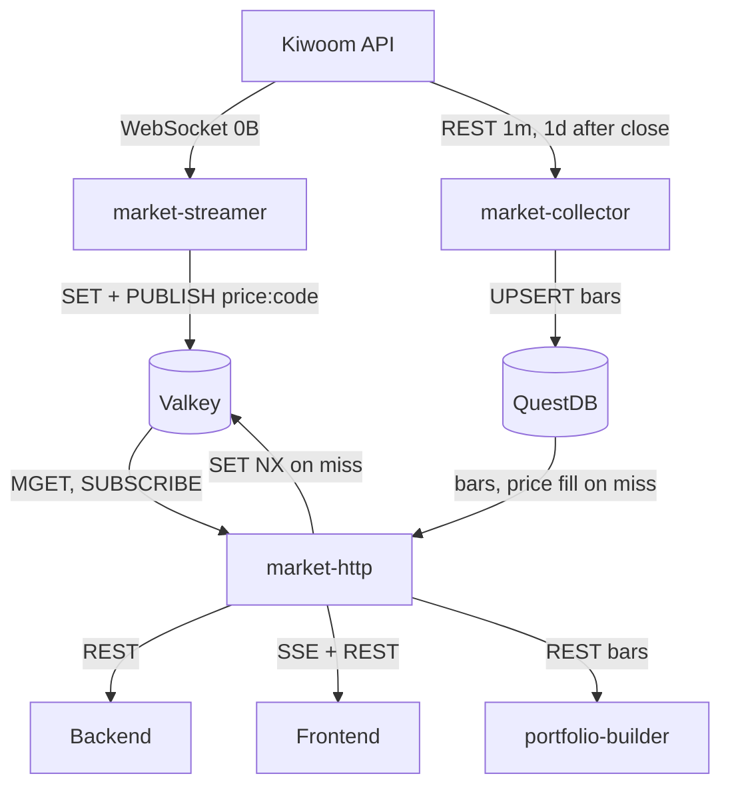

# market-streamer and market-http

**Date:** 2026-10-13  
**Status:** Draft for review

## Purpose

The Backend and Frontend need live KOSPI 200 prices, and every consumer of market history should go through one HTTP surface instead of reading QuestDB directly.

- **market-streamer** holds one Kiwoom `0B` (주식체결) WebSocket session for all KOSPI 200 stocks and writes each tick to Valkey.
- **market-http** serves current prices from Valkey (REST and SSE) and historical OHLCV from QuestDB.
- **market-collector** runs every minute so QuestDB history is at most about a minute old.
- **portfolio-builder** reads bars through market-http and no longer reads QuestDB.



Valkey is a local container in development and ElastiCache Serverless (Valkey) in production.

## Valkey contract

One key and one channel per stock, both named `price:{code}` (e.g. `price:005930`). The key holds, and each message carries, the same JSON:

```json
{"code": "005930", "price": 82000, "change": -500, "rate": -0.61, "volume": 12345678, "ts": "2026-10-13T09:01:23+09:00"}
```

- `price` and `change` are integers in KRW; `rate` is percent; `volume` is today's cumulative volume.
- Keys have no TTL. The last price stays valid overnight and over weekends.

### Connection

market-streamer and market-http each have their own `valkey.py` that builds an asyncio `redis` client from settings. Nothing goes into `ktb-core`, which stays free of third-party dependencies.

- `VALKEY_AUTH_MODE=none` connects with no credentials (development).
- `VALKEY_AUTH_MODE=iam` uses a redis-py credential provider that returns `VALKEY_USERNAME` and an ElastiCache IAM token presigned with botocore for `VALKEY_CACHE_NAME` (`ResourceType=ServerlessCache`) in `AWS_REGION`. The token lasts 15 minutes, so the provider makes a new one on every connect.
- `VALKEY_TLS=true` enables TLS.

The production host's role needs `elasticache:Connect` on the serverless cache and its user. That is infrastructure outside this repository.

## market-streamer

A long-running asyncio worker. It is not an HTTP server and has no FastAPI.

### Run loop

1. Load KOSPI 200 codes from `corporation_indices` (`index_name = INDEX_NAME`), like market-collector's `load_symbols`.
2. Open a `kwcli` `KiwoomWebSocketClient` on `/api/dostk/websocket` and send one `REG` (`build_reg_packet(codes, ["0B"])`) for all 200 codes.
3. Read with `iter_messages()`. For each `REAL` frame, handle every `data[]` entry with `type == "0B"` in order, serially.
4. When the connection closes or errors, reconnect with capped exponential backoff (1s doubling to 30s), log in again and send `REG` again. The backoff resets after a successful `REG`.
5. When KST time passes `STOP_AT` (default `15:40`), close the socket and exit 0.

### Per tick

| Field | FID | Parsing |
|---|---|---|
| `price` | 10 | strip ASCII spaces and the `+`/`-` sign, `int` |
| `change` | 11 | strip spaces, signed `int` |
| `rate` | 12 | strip spaces, signed `float` |
| `volume` | 13 | strip spaces and sign, `int` |
| `ts` | 20 | `HHMMSS` combined with today's KST date |

One pipeline per frame: `SET price:{code} <json>` and `PUBLISH price:{code} <json>` for each entry. A malformed entry is logged and skipped; it never stops the stream.

### Schedule

`ktb-market-streamer.timer` starts `ktb-market-streamer.service` at `Mon..Fri 08:50` Asia/Seoul. The service is `Type=simple` and runs `docker compose run --rm -T market-streamer` under `flock -n -E 0`, with the same `OnSuccess`/`OnFailure` hooks as the other jobs. It stops itself at `STOP_AT`; `RuntimeMaxSec` is not used because systemd would report that as a failure. On a holiday the feed is silent until `STOP_AT`.

### Settings (`MARKET_STREAMER_`)

| Variable | Default |
|---|---|
| `POSTGRES_DSN` | required |
| `KIWOOM_APP_KEY` | required |
| `KIWOOM_SECRET_KEY` | required |
| `KIWOOM_MODE` | `real` |
| `INDEX_NAME` | `KOSPI200` |
| `STOP_AT` | `15:40` |
| `VALKEY_HOST` | required |
| `VALKEY_PORT` | `6379` |
| `VALKEY_USERNAME` | — |
| `VALKEY_CACHE_NAME` | — (required when `iam`) |
| `VALKEY_TLS` | `false` |
| `VALKEY_AUTH_MODE` | `none` |
| `AWS_REGION` | `ap-northeast-2` |
| `LOG_LEVEL` | `INFO` |

## market-collector changes

### Schedule

`ktb-market-collector.timer` changes from hourly to every minute:

```
OnCalendar=Mon..Fri *-*-* 09..14:*:05 Asia/Seoul
OnCalendar=Mon..Fri *-*-* 15:00..30:05 Asia/Seoul
OnCalendar=Mon..Fri *-*-* 15:35:05 Asia/Seoul
```

The existing `flock -n -E 0` makes a run that starts while the previous one is still going exit successfully, so a slow minute or a first backfill skips ticks without raising the failure alarm.

### Timeframes

`archive_ohlcv` collects `("1m",)` before 15:35 KST and `("1m", "1d")` from 15:35 KST.

### Rate

Production compose sets `MARKET_COLLECTOR_REQUEST_INTERVAL=0.25` (4 req/s, under Kiwoom's 5 req/s per key). 200 stocks with one page each take about 50 seconds. The code default stays `1.3`. market-streamer's single WebSocket session does not count against the REST limit.

### Reconcile re-fetches the checkpoint bar

`reconcile_candles` currently keeps only `bar.ts > latest`, so a bar saved while its minute was still forming is never corrected. The filter becomes `bar.ts >= latest`: the checkpoint bar is written again and `DEDUP UPSERT KEYS(ts, symbol, timeframe)` overwrites it. Paging already stops at the page holding the checkpoint, so no extra request is made. For 1d, the 15:35 run rewrites the previous daily bar once and writes today's.

## market-http

A FastAPI service laid out like news-http (`app.py`, `controllers/`, `__main__.py` with uvicorn). It is public with no authentication. CORS allows any origin for `GET`. Rate limiting and connection limits belong to the ALB, not this service.

### `GET /prices?codes=005930,000660`

`MGET price:{code}` for every code. For codes that are missing, market-http queries QuestDB, writes each result with `SET NX` (never overwriting a live streamed price), and includes it in the response. Codes with no data in QuestDB either are left out. Response: a list of price objects.

The QuestDB fill:

- `price`, `ts`: the latest `bars_1m` row per symbol (`LATEST ON ts PARTITION BY symbol`).
- `change`, `rate`: against the latest regular-session `bars_1d` close dated before the bar's KST day.
- `volume`: sum of that KST day's `bars_1m` volume.

### `GET /prices/stream?codes=005930,000660`

SSE with FastAPI's built-in `EventSourceResponse`/`ServerSentEvent`.

1. Send one `price` event per code from the same lookup as `/prices`, including the QuestDB fill.
2. `SUBSCRIBE price:{code}` for every code and send each message as a `price` event.
3. When 15 seconds pass without a message, send an SSE comment so the ALB idle timeout does not close quiet streams.

Each SSE client holds its own pub/sub connection. A GitHub issue tracks moving to one shared subscription fanned out in-process when connection count needs it.

### `GET /bars/{code}?timeframe=1m&limit=300&cursor=...`

Response: `{"items": [{"ts", "open", "high", "low", "close", "volume"}], "next_cursor": str | null}`, newest first.

- `timeframe` is one of `1m`, `15m`, `1h`, `1d`, reading `bars_1m`, `bars_15m`, `bars_1h`, `bars_1d`. `1m` and `1d` keep only `session = 'regular'`.
- `limit` is 1 to 1000, default 300. The query fetches `limit + 1` rows to tell whether a next page exists.
- The cursor is the urlsafe base64 of the last item's ISO `ts`. The next page is `ts < cursor`. `ts` is unique per symbol and timeframe, so no tiebreaker is needed.
- An unknown timeframe or an invalid cursor returns 422.

QuestDB handlers are sync and run in FastAPI's threadpool with the official `questdb` client.

### `GET /health`

`{"status": "ok"}`.

### Settings (`MARKET_HTTP_`)

| Variable | Default |
|---|---|
| `QUESTDB_CONF` | required |
| `VALKEY_HOST` | required |
| `VALKEY_PORT` | `6379` |
| `VALKEY_USERNAME` | — |
| `VALKEY_CACHE_NAME` | — (required when `iam`) |
| `VALKEY_TLS` | `false` |
| `VALKEY_AUTH_MODE` | `none` |
| `AWS_REGION` | `ap-northeast-2` |
| `HOST` | `0.0.0.0` |
| `PORT` | `8000` |
| `LOG_LEVEL` | `INFO` |

## portfolio-builder changes

`QuestDBMarket` is replaced by `HttpMarket`, which calls market-http with sync `httpx` like its news-http client.

- `bars(symbol, timeframe)`: one `GET /bars/{symbol}?timeframe=...&limit=300`, reversed to oldest first before building `Bars`. The returned `as_of` is the newest bar's `ts`.
- `universe_closes()`: KOSPI 200 members still come from PostgreSQL. It then calls `GET /bars/{code}?timeframe=1d&limit=300` once per member, in sequence. It is already cached once per run.

`PORTFOLIO_BUILDER_QUESTDB_CONF` and the `questdb` dependency are removed. `PORTFOLIO_BUILDER_MARKET_HTTP_BASE_URI` is added (required; `http://market-http:8000` in compose).

portfolio-rebalancer is out of scope and keeps reading QuestDB.

## Wiring

- **Workspace:** `services/market-streamer` (script `market-streamer`) and `services/market-http` (script `market-http`). Both depend on `ktb-core`, `pydantic-settings`, `redis` and `botocore`. market-streamer adds `kwcli`, `sqlalchemy` and `psycopg[binary]`; market-http adds `fastapi`, `uvicorn` and `questdb`.
- **Images:** `docker/market-streamer.Dockerfile` and `docker/market-http.Dockerfile` follow the per-service pattern; both are added to `app.Dockerfile`'s install line. After `uv lock`, export `docker/requirements/<svc>.txt` and `app.txt` with the exact commands in `AGENTS.md`, and regenerate `portfolio-builder.txt`.
- **compose.dev.yaml:** a `valkey` container (`valkey/valkey`, pinned tag, `127.0.0.1:6379`), `market-streamer`, and `market-http` on `127.0.0.1:8001`.
- **compose.prod.yaml:** `market-streamer` under `profiles: ["jobs"]`; `market-http` long-running with a published host port for the ALB target group. Every variable is interpolated from its own prefixed name; there are no shared `VALKEY_*` variables. `MARKET_COLLECTOR_REQUEST_INTERVAL` defaults to `0.25`.
- **systemd:** new `ktb-market-streamer.service.in` and `.timer`; updated `ktb-market-collector.timer`.
- **Docs:** `AGENTS.md` and `README.md` env tables, member table and architecture notes. market-http becomes the second inbound HTTP surface and is public; portfolio-builder no longer reads QuestDB.

## Verification

Datastore tests use a real instance when their variable is set and skip otherwise, like `KTB_TEST_QUESTDB_CONF`. A new `KTB_TEST_VALKEY_URL` covers Valkey.

- **market-collector** (`test_reconcile.py`, `test_main.py`):
  1. Runs at 09:00:05 and 09:01:05: the second run rewrites the 09:00 bar with its finished OHLCV and adds 09:01.
  2. A run at 15:35:05 rewrites the 15:30 bar written while forming and writes today's 1d bar; runs before 15:35 do not request 1d.
  3. A first run (`latest is None`) still caps at `LIMITS` and writes no bar twice.
- **market-streamer:** tick parsing including signed and space-padded values; the `REG` packet carries all 200 codes; a dropped connection reconnects and sends `REG` again; passing `STOP_AT` exits 0; one frame produces `SET` and `PUBLISH` per entry in Valkey.
- **market-http:** `/prices` hit; `/prices` miss filled from QuestDB with `SET NX` that leaves an existing key untouched; SSE sends the snapshot and then a published event; `/bars` pages across two pages via the cursor; an invalid cursor and an unknown timeframe return 422.
- **portfolio-builder:** `HttpMarket` against a stubbed `httpx` transport.

### Check against the live API before implementation

1. One Kiwoom key is used by two processes. Confirm that market-collector issuing a token does not end market-streamer's WebSocket session, and the reverse.
2. Confirm the `0B` formats for KOSPI: integer prices, and FID 20 as `HHMMSS` in KST.
3. Confirm one `REG` with 200 codes delivers ticks for all 200.

## Boundaries

- market-streamer writes only Valkey. market-collector remains the only QuestDB writer.
- market-http writes Valkey only to fill missing keys, and only with `SET NX`.
- No tick history in Valkey, no publish throttling, no stream cap or rate limit in code.
- KOSPI 200 membership changes reach market-streamer on its next daily start.
- portfolio-rebalancer is unchanged.
